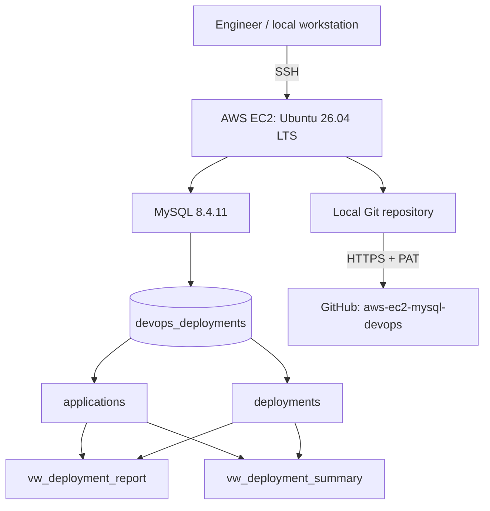
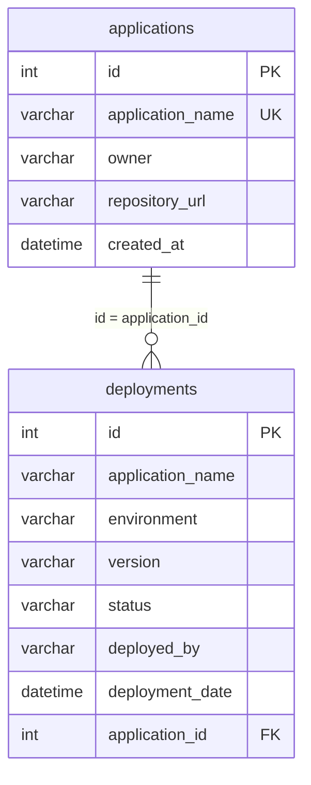

# AWS EC2 + MySQL DevOps Deployment Tracker

> **Hands-on portfolio project:** Provision and administer a MySQL database on an Ubuntu EC2 instance; model application deployments; analyze release outcomes with SQL; secure access with least privilege; test backup/restore; and version-control the work in GitHub.

**Repository:** https://github.com/johnson-busuyi/aws-ec2-mysql-devops  
**Project database:** `devops_deployments`  
**Environment used:** AWS EC2 / Ubuntu 26.04 LTS / MySQL 8.4.11 / Git 2.53.0  
**Status:** Working database and reporting views; local Git repository pushed to GitHub.

> **Scope and safety:** This is a learning project with illustrative deployment records, not a production deployment platform. MySQL is administered locally on the EC2 host; there is **no requirement to expose TCP 3306 to the internet**. Never publish real credentials, private keys, sensitive data, or database dumps.

---

## Table of Contents

1. [Project goals](#1-project-goals)
2. [Architecture and tools](#2-architecture-and-tools)
3. [Prerequisites and AWS security](#3-prerequisites-and-aws-security)
4. [Ubuntu and MySQL setup](#4-ubuntu-and-mysql-setup)
5. [Database schema and relationship](#5-database-schema-and-relationship)
6. [Repository structure and SQL execution order](#6-repository-structure-and-sql-execution-order)
7. [SQL exercises: CRUD and reporting](#7-sql-exercises-crud-and-reporting)
8. [JOINs, aggregation, and deployment metrics](#8-joins-aggregation-and-deployment-metrics)
9. [Views and reporting](#9-views-and-reporting)
10. [Transactions and recovery exercises](#10-transactions-and-recovery-exercises)
11. [Foreign keys and referential integrity](#11-foreign-keys-and-referential-integrity)
12. [MySQL users and least privilege](#12-mysql-users-and-least-privilege)
13. [Backups and restore testing](#13-backups-and-restore-testing)
14. [Git and GitHub workflow](#14-git-and-github-workflow)
15. [Troubleshooting log](#15-troubleshooting-log)
16. [Validation checklist](#16-validation-checklist)
17. [Security, limitations, and improvements](#17-security-limitations-and-improvements)
18. [Interview talking points and lessons learned](#18-interview-talking-points-and-lessons-learned)

---

## 1. Project goals

This project simulates a DevOps deployment tracking database. It records applications, ownership, repositories, deployment environments, versions, operators, timestamps, and deployment outcomes.

The hands-on learning objectives were to:

- Use SSH and the Ubuntu shell to administer an AWS EC2 server.
- Install, start, and verify MySQL.
- Create relational tables and load representative data.
- Practice `INSERT`, `SELECT`, `WHERE`, `ORDER BY`, `UPDATE`, and `DELETE`.
- Apply aggregate functions, `GROUP BY`, `HAVING`, and `CASE`.
- Join application metadata with deployment history.
- Enforce a foreign key and investigate constraint failures.
- Create reusable reporting views.
- Use `START TRANSACTION`, `ROLLBACK`, and `COMMIT` deliberately.
- Implement separate operational and reporting database accounts.
- Verify that prohibited database actions fail.
- Create and test a logical backup.
- Store safe SQL scripts and documentation in Git and GitHub.

**Why this is relevant to DevOps:** Database-backed services require reliable data models, controlled access, recovery procedures, reproducible configuration, and clear operational reporting.

## 2. Architecture and tools



| Component | Observed version / role | Why used |
|---|---|---|
| AWS EC2 | Linux virtual machine, with an Elastic IP in the lab | Provides a cloud-hosted server |
| Ubuntu | 26.04 LTS | Linux administration and package management |
| MySQL | 8.4.11 | Relational data storage, queries, views, constraints, accounts |
| InnoDB | Storage engine for both tables | Transaction support and foreign keys |
| Git | 2.53.0 | Local history, commits, and change tracking |
| GitHub | Remote `main` branch | Portfolio publication and collaboration |
| Bash / SSH | Server shell and secure remote access | Run commands and administer EC2 |
| `mysqldump` | MySQL logical export utility | Back up data and export schema |

**Networking:** SSH is used to reach the EC2 host. Database commands in this project run on the server against the local MySQL service. Opening MySQL to the public internet is unnecessary.

## 3. Prerequisites and AWS security

Prerequisites for a similar lab:

- An AWS account and EC2 Ubuntu instance.
- An SSH key or other approved EC2 access method.
- An appropriately restricted security group (SSH from trusted source addresses).
- Sufficient instance storage and memory for Ubuntu and MySQL.
- A GitHub account for the remote repository.

Illustrative SSH command (replace the placeholders):

```bash
chmod 400 /path/to/your-ec2-key.pem
ssh -i /path/to/your-ec2-key.pem ubuntu@YOUR_EC2_PUBLIC_IP
```

**Do not commit the `.pem` file.** If using an Elastic IP, understand that AWS networking and billing settings can vary. Stop unused instances and review costs.

Verify the operating system:

```bash
cat /etc/os-release
uname -a
```

## 4. Ubuntu and MySQL setup

The commands below are a **reproducible setup reference**, not a verbatim record of every installation command used earlier in the lab. Package availability may differ by Ubuntu release; verify the actual repository candidate before installing.

```bash
sudo apt update
apt-cache policy mysql-server
sudo apt install mysql-server
sudo systemctl enable --now mysql
sudo systemctl status mysql --no-pager
mysql --version
```

In the completed lab, the MySQL server reported version **8.4.11**. A fresh `apt install` may install a different version depending on the enabled package repositories.

For local administrative access on Ubuntu, where the root account is configured for socket authentication:

```bash
sudo mysql
```

From the `mysql>` prompt:

```sql
SELECT VERSION();
SHOW DATABASES;
EXIT;
```

Other useful commands:

```bash
sudo systemctl is-active mysql
sudo systemctl restart mysql   # only when an intentional restart is appropriate
sudo journalctl -u mysql --no-pager -n 50
```

**Prompt awareness:** Run `sudo mysql`, `mysqldump`, `git`, `nano`, and `cd` at the **Ubuntu shell**. Run `SELECT`, `CREATE TABLE`, and `SHOW GRANTS` at the **MySQL prompt** (or pass SQL via `mysql -e`).

## 5. Database schema and relationship

### 5.1 Create and select the database

```sql
CREATE DATABASE IF NOT EXISTS devops_deployments;
USE devops_deployments;
```

### 5.2 `applications` table

The actual exported schema from the lab:

```sql
CREATE TABLE applications (
  id INT NOT NULL AUTO_INCREMENT,
  application_name VARCHAR(100) NOT NULL,
  owner VARCHAR(100) DEFAULT NULL,
  repository_url VARCHAR(255) DEFAULT NULL,
  created_at DATETIME DEFAULT CURRENT_TIMESTAMP,
  PRIMARY KEY (id),
  UNIQUE KEY application_name (application_name)
) ENGINE=InnoDB DEFAULT CHARSET=utf8mb4;
```

### 5.3 `deployments` table

```sql
CREATE TABLE deployments (
  id INT NOT NULL AUTO_INCREMENT,
  application_name VARCHAR(100) NOT NULL,
  environment VARCHAR(50) NOT NULL,
  version VARCHAR(30) DEFAULT NULL,
  status VARCHAR(30) NOT NULL,
  deployed_by VARCHAR(100) DEFAULT NULL,
  deployment_date DATETIME DEFAULT CURRENT_TIMESTAMP,
  application_id INT NOT NULL,
  PRIMARY KEY (id),
  KEY fk_deployments_application (application_id),
  CONSTRAINT fk_deployments_application
    FOREIGN KEY (application_id)
    REFERENCES applications(id)
    ON DELETE RESTRICT
    ON UPDATE RESTRICT
) ENGINE=InnoDB DEFAULT CHARSET=utf8mb4;
```

The actual `mysqldump` export also included session setup statements such as `/*!40101 ... */`, explicit collation `utf8mb4_0900_ai_ci`, and `AUTO_INCREMENT=5` / `AUTO_INCREMENT=17` reflecting the original table state. These are normal export details.

**Relationship:** `applications.id` (parent) → `deployments.application_id` (child), one-to-many. The `deployments.application_name` column is redundant with the parent name; it was retained as part of the learning dataset. A production redesign could rely on `application_id` as the canonical relationship and join to obtain the name.



Verify table structure and constraints:

```sql
DESCRIBE applications;
DESCRIBE deployments;
SHOW CREATE TABLE deployments\G

SELECT TABLE_NAME, COLUMN_NAME, CONSTRAINT_NAME,
       REFERENCED_TABLE_NAME, REFERENCED_COLUMN_NAME
FROM information_schema.KEY_COLUMN_USAGE
WHERE TABLE_SCHEMA = 'devops_deployments'
  AND REFERENCED_TABLE_NAME IS NOT NULL;
```

## 6. Repository structure and SQL execution order

```text
aws-ec2-mysql-devops/
├── README.md
├── .gitignore
├── sql/
│   ├── 01_database_schema.sql
│   ├── 02_sample_data.sql
│   ├── 03_sql_queries.sql
│   ├── 04_joins.sql
│   ├── 05_views.sql
│   └── 06_user_permissions.sql
├── exercises/         # optional future exercise notes
├── troubleshooting/   # optional detailed incident notes
└── screenshots/       # optional redacted evidence
```

> Empty directories are not tracked by Git. The original first commit contained eight files: the README, `.gitignore`, and six SQL files.

### Recommended order for a **new, disposable database**

1. Review all scripts and remove private URLs, credentials, and sensitive information.
2. Create the target database.
3. Run `01_database_schema.sql` **only in a new empty database**.
4. Run `02_sample_data.sql` once to load demonstration records.
5. Run `03_sql_queries.sql` and `04_joins.sql` (read-only).
6. Review `05_views.sql` against the desired view definitions and apply it only in a test environment first.
7. Treat `06_user_permissions.sql` as a **documentation template**, not a ready-to-run production migration.

Example for a newly prepared lab database:

```bash
sudo mysql -e "CREATE DATABASE IF NOT EXISTS devops_deployments;"
sudo mysql devops_deployments < sql/01_database_schema.sql
sudo mysql devops_deployments < sql/02_sample_data.sql
sudo mysql < sql/03_sql_queries.sql
sudo mysql < sql/04_joins.sql
```

**Important:** The original schema dump contains no `CREATE DATABASE` statement. The exported schema and sample data may not be safe to rerun on a populated database. Re-running `INSERT` statements may cause duplicate-key errors. The original views already exist in the working database; do not replace them casually. For fully isolated replay, adapt the scripts to a separate test database and check their `USE devops_deployments` statements.

### Export commands used to prepare the repository

Schema only:

```bash
sudo mysqldump \
  --no-data --no-tablespaces --skip-triggers \
  --skip-add-drop-table --skip-comments --skip-dump-date \
  --set-gtid-purged=OFF \
  devops_deployments applications deployments \
  > sql/01_database_schema.sql
```

Data only:

```bash
sudo mysqldump \
  --no-create-info --no-tablespaces --skip-triggers \
  --skip-comments --skip-dump-date \
  --set-gtid-purged=OFF --complete-insert \
  devops_deployments applications deployments \
  > sql/02_sample_data.sql
```

`--complete-insert` makes inserted column names explicit. `--no-data` omits records; `--no-create-info` omits table definitions. Review every export before publication.

## 7. SQL exercises: CRUD and reporting

The following queries illustrate concepts practiced in the lab. Execute data-changing exercises **only in a disposable copy** or after verifying a backup and transaction plan.

### 7.1 Read records

```sql
USE devops_deployments;

SELECT * FROM applications;
SELECT * FROM deployments;
SELECT * FROM deployments WHERE status = 'Success';
SELECT * FROM deployments WHERE status = 'Failed';
SELECT * FROM deployments WHERE environment = 'Production';
SELECT * FROM deployments
ORDER BY deployment_date DESC, id DESC
LIMIT 5;
```

- `SELECT` reads data.
- `WHERE` filters records.
- `ORDER BY` sorts results.
- `LIMIT` returns a smaller result set.

### 7.2 Insert

```sql
-- Illustration only: choose a unique application name in a test database.
INSERT INTO applications (application_name, owner, repository_url)
VALUES ('ExampleService', 'Demo Team', 'https://example.com/demo-repo');
```

`INSERT` creates a new row. The unique key prevents duplicate `application_name` values.

### 7.3 Update

```sql
-- Illustration only: test database, with a specific WHERE clause.
UPDATE applications
SET owner = 'Platform Team'
WHERE application_name = 'ExampleService';
```

`UPDATE` changes existing rows. Always inspect the intended rows first:

```sql
SELECT * FROM applications
WHERE application_name = 'ExampleService';
```

### 7.4 Delete

```sql
-- Illustration only: delete a disposable row with no dependent deployments.
DELETE FROM applications
WHERE application_name = 'ExampleService';
```

`DELETE` removes rows. A referenced parent application cannot be deleted while child deployments exist because of `ON DELETE RESTRICT`.

### 7.5 Aggregation

```sql
SELECT COUNT(*) AS total_deployments FROM deployments;

SELECT status, COUNT(*) AS total
FROM deployments
GROUP BY status;

SELECT application_name, COUNT(*) AS total
FROM deployments
GROUP BY application_name
HAVING COUNT(*) > 1;
```

- `COUNT` measures rows.
- `GROUP BY` creates summary groups.
- `HAVING` filters aggregated groups.

### 7.6 Overall deployment success rate

```sql
SELECT
  COUNT(*) AS total_deployments,
  SUM(CASE WHEN status = 'Success' THEN 1 ELSE 0 END) AS successful,
  ROUND(
    100.0 * SUM(CASE WHEN status = 'Success' THEN 1 ELSE 0 END)
    / NULLIF(COUNT(*), 0),
    2
  ) AS success_rate_percent
FROM deployments;
```

`NULLIF(COUNT(*), 0)` avoids division by zero if there are no records.

## 8. JOINs, aggregation, and deployment metrics

### 8.1 INNER JOIN: match deployments to their application owners

```sql
SELECT
  a.application_name, a.owner, d.environment,
  d.version, d.status, d.deployed_by, d.deployment_date
FROM applications AS a
INNER JOIN deployments AS d
  ON a.id = d.application_id
ORDER BY d.id;
```

**Why:** It adds application metadata to individual deployment events.

### 8.2 LEFT JOIN: include applications without deployments

```sql
SELECT a.application_name, a.owner, d.environment, d.status
FROM applications AS a
LEFT JOIN deployments AS d
  ON a.id = d.application_id;
```

**Why:** An application should remain visible in an inventory report even when it has no deployment history.

### 8.3 Investigate failed deployments

```sql
SELECT
  a.application_name, a.owner, d.environment,
  d.version, d.deployed_by, d.deployment_date
FROM applications AS a
JOIN deployments AS d ON a.id = d.application_id
WHERE d.status = 'Failed'
ORDER BY d.deployment_date DESC;
```

**Why:** It supports release investigation and identifies the responsible application team.

### 8.4 Summarize deployment status by application

```sql
SELECT
  a.application_name,
  COUNT(d.id) AS total_deployments,
  SUM(CASE WHEN d.status = 'Success' THEN 1 ELSE 0 END) AS successful,
  SUM(CASE WHEN d.status = 'Failed' THEN 1 ELSE 0 END) AS failed,
  SUM(CASE WHEN d.status = 'Pending' THEN 1 ELSE 0 END) AS pending
FROM applications AS a
LEFT JOIN deployments AS d ON a.id = d.application_id
GROUP BY a.id, a.application_name;
```

### 8.5 Initial demonstration results

| Application | Total | Success | Failed | Pending | Success rate |
|---|---:|---:|---:|---:|---:|
| CartFlow | 7 | 7 | 0 | 0 | 100% |
| PaymentAPI | 3 | 0 | 3 | 0 | 0% |
| CustomerChurn | 3 | 3 | 0 | 0 | 100% |
| InventoryAPI | 3 | 0 | 0 | 3 | 0% |
| **Total** | **16** | **10** | **3** | **3** | **62.50% overall** |

The overall percentage is `10 / 16 × 100 = 62.50%`; it is **not** the simple average of the four per-application rates.

## 9. Views and reporting

Two views were created and tested:

### 9.1 Detailed report

```sql
CREATE OR REPLACE
SQL SECURITY DEFINER
VIEW vw_deployment_report AS
SELECT
  d.id AS deployment_id,
  a.application_name,
  a.owner,
  a.repository_url,
  d.environment,
  d.version,
  d.status,
  d.deployed_by,
  d.deployment_date
FROM deployments AS d
INNER JOIN applications AS a
  ON d.application_id = a.id;
```

### 9.2 Deployment summary

```sql
CREATE OR REPLACE
SQL SECURITY DEFINER
VIEW vw_deployment_summary AS
SELECT
  a.application_name,
  a.owner,
  COUNT(d.id) AS total_deployments,
  COUNT(CASE WHEN d.status = 'Success' THEN 1 END) AS successful,
  COUNT(CASE WHEN d.status = 'Failed' THEN 1 END) AS failed,
  COUNT(CASE WHEN d.status = 'Pending' THEN 1 END) AS pending
FROM applications AS a
LEFT JOIN deployments AS d ON a.id = d.application_id
GROUP BY a.id, a.application_name, a.owner;
```

These definitions match the columns and query logic observed from `SHOW CREATE VIEW` in the working lab. The existing views reported:

- `DEFINER = root@localhost`
- `SQL SECURITY DEFINER`
- `ALGORITHM=UNDEFINED`

**Security nuance:** A `SQL SECURITY DEFINER` view uses its definer's privileges to access underlying tables. A user can therefore be granted `SELECT` on the view without direct table access. In production, prefer a **dedicated least-privileged definer account** instead of root. Creating/replacing a view under a different account can change its definer and affect access; test first.

Verification:

```sql
SHOW CREATE VIEW vw_deployment_report\G
SHOW CREATE VIEW vw_deployment_summary\G
SELECT COUNT(*) AS deployment_records FROM vw_deployment_report;
SELECT * FROM vw_deployment_summary;
```

**Do not blindly run `05_views.sql` against the existing working database.** The initial draft of that file omitted `deployment_id` and `owner`; it was corrected after comparing the live definitions. The correct live schema is the source of truth.

## 10. Transactions and recovery exercises

Transactions group changes so they can be committed together or rolled back before commit.

### 10.1 Safe rollback practice

```sql
-- Use a disposable test database.
START TRANSACTION;

UPDATE deployments
SET status = 'Pending'
WHERE id = 1;

SELECT id, status FROM deployments WHERE id = 1;

ROLLBACK;

SELECT id, status FROM deployments WHERE id = 1;
```

`ROLLBACK` cancels uncommitted transactional changes. InnoDB supports this behavior.

### 10.2 Commit practice

```sql
-- Use a disposable test database.
START TRANSACTION;

UPDATE deployments
SET status = 'Success'
WHERE id = 1;

SELECT id, status FROM deployments WHERE id = 1;

COMMIT;
```

`COMMIT` makes the transaction's changes permanent. A subsequent `ROLLBACK` cannot undo an already committed transaction.

### 10.3 Actual lab incident: UPDATE without WHERE

During the learning exercises, an `UPDATE` without an adequate `WHERE` clause unintentionally modified **six of sixteen** deployment records. The records were subsequently corrected using a targeted `CASE` expression within a transaction, then committed after review.

Illustrative recovery pattern (IDs and intended values must be verified against actual data):

```sql
START TRANSACTION;

UPDATE deployments
SET status = CASE id
  WHEN 1 THEN 'Success'
  WHEN 2 THEN 'Failed'
  ELSE status
END
WHERE id IN (1, 2);

SELECT id, application_name, status
FROM deployments
WHERE id IN (1, 2);

-- COMMIT only after confirming each row is correct.
-- Otherwise use ROLLBACK.
```

**Lessons:** Always use a restrictive `WHERE`, check the target rows before changing them, verify affected-row counts, and test recovery procedures. `CASE` is useful when several rows require different corrected values.

## 11. Foreign keys and referential integrity

The `deployments.application_id` column references `applications.id`:

```sql
CONSTRAINT fk_deployments_application
FOREIGN KEY (application_id)
REFERENCES applications(id)
ON DELETE RESTRICT
ON UPDATE RESTRICT
```

- A deployment must reference an existing application.
- Referenced application IDs cannot be changed or deleted while dependent deployments exist.
- The foreign key was verified with `SHOW CREATE TABLE` and `information_schema.KEY_COLUMN_USAGE`.
- MySQL reported **Error 1826** when an attempt was made to add a foreign key using an already existing constraint name; the correct response was to inspect the existing constraint, not duplicate it.

Foreign keys are a database-level safeguard, but they do not replace application validation.

## 12. MySQL users and least privilege

The lab implemented two local accounts:

| Account | Allowed | Intentionally denied |
|---|---|---|
| `devops_user@localhost` | `SELECT`, `INSERT`, `UPDATE` on `devops_deployments.*` | `DELETE`, database creation/admin |
| `report_user@localhost` | `SELECT` on `vw_deployment_report` and `vw_deployment_summary` | Direct reads of base tables, writes, database creation |

### 12.1 Permission examples — administrator-only template

The SQL below illustrates intended grants; **do not execute it unchanged on your existing server**. Provision passwords using an approved secure workflow and verify/revoke unintended grants separately.

```sql
GRANT SELECT, INSERT, UPDATE
ON devops_deployments.*
TO 'devops_user'@'localhost';

GRANT SELECT
ON devops_deployments.vw_deployment_report
TO 'report_user'@'localhost';

GRANT SELECT
ON devops_deployments.vw_deployment_summary
TO 'report_user'@'localhost';

SHOW GRANTS FOR 'devops_user'@'localhost';
SHOW GRANTS FOR 'report_user'@'localhost';
```

The repository's `06_user_permissions.sql` is a **template**, not a secret store. The placeholder `REPLACE_WITH_SECURE_PASSWORD` must never be treated as a real credential. `CREATE USER IF NOT EXISTS` does not reset an existing account's password; `GRANT` adds privileges but does not remove earlier grants.

### 12.2 Verified negative tests

- `devops_user` could query the 16 deployment records.
- Attempting `CREATE DATABASE` as `devops_user` produced **Error 1044**.
- Attempting `DELETE` as `devops_user` produced **Error 1142**.
- `report_user` could query `vw_deployment_summary`, returning four application rows.
- Attempting direct `SELECT` from `deployments` as `report_user` produced **Error 1142**.

These failures were **expected and desirable**: they demonstrated that access controls worked.

### 12.3 Authentication lesson

An initial `report_user` login failed with **Error 1045**. The password was reset by an administrator using MySQL's random-password generation capability, and login subsequently succeeded. **No password is stored in this repository.**

## 13. Backups and restore testing

### 13.1 Logical backup

The lab created a database dump before foreign-key work:

```bash
mkdir -p ~/mysql-backups

sudo mysqldump \
  --single-transaction \
  --no-tablespaces \
  devops_deployments \
  > ~/mysql-backups/devops_deployments_before_fk.sql
```

**Why the options matter:**

- `--single-transaction` provides a transactionally consistent snapshot for InnoDB tables under appropriate conditions.
- `--no-tablespaces` avoids tablespace metadata in the dump.
- `>` writes the export to a file.

Check the file:

```bash
ls -lh ~/mysql-backups/devops_deployments_before_fk.sql
```

**Security:** A dump may contain real records, internal repository URLs, and other sensitive information. Keep backups outside the Git repository and protect them with appropriate permissions, storage controls, and retention policies.

### 13.2 Restore into a separate test database

The lab restored the backup into `devops_deployments_test` and verified it independently of the primary database.

For a dump that does **not** contain an explicit `CREATE DATABASE` / `USE` selecting the original schema:

```bash
sudo mysql -e "CREATE DATABASE IF NOT EXISTS devops_deployments_test;"
sudo mysql devops_deployments_test \
  < ~/mysql-backups/devops_deployments_before_fk.sql
```

**Check the dump first:** If it contains `CREATE DATABASE` or `USE devops_deployments`, the import may target the original database despite the command-line database name. Never run an uninspected dump against production.

Validation:

```bash
sudo mysql -D devops_deployments_test -e "
SHOW TABLES;
SELECT COUNT(*) AS applications FROM applications;
SELECT COUNT(*) AS deployments FROM deployments;
"
```

A backup is only operationally useful if restoration has been tested. The backup used for the lab was captured **before** later schema changes, so its contents may not match the final foreign-key state.

### 13.3 Recommended improvements

For production, add automated scheduled backups, encryption at rest and in transit, off-instance/off-region storage as appropriate, retention rules, restore drills, monitoring, and documented recovery objectives.

## 14. Git and GitHub workflow

### 14.1 Install or verify Git

```bash
git --version
# Observed in this lab: git version 2.53.0
```

### 14.2 Initialize a local repository

```bash
mkdir -p ~/aws-ec2-mysql-devops
cd ~/aws-ec2-mysql-devops
git init -b main
git status
```

### 14.3 Create project folders and files

```bash
mkdir -p sql exercises troubleshooting screenshots
touch README.md .gitignore
touch sql/01_database_schema.sql sql/02_sample_data.sql \
      sql/03_sql_queries.sql sql/04_joins.sql \
      sql/05_views.sql sql/06_user_permissions.sql
```

### 14.4 Keep secrets out of version control

Example `.gitignore` rules:

```gitignore
.env
.env.*
!.env.example
*.pem
*.key
*.p12
*.pfx
*.dump
*.bak
*.sql.gz
backups/
mysql-backups/
exports/
*.log
*.tmp
*.swp
*~
```

**Do not ignore `*.sql` globally**, because the project's SQL scripts should be tracked. `.gitignore` does not protect a secret written inside a tracked SQL file; review contents before committing.

Basic review:

```bash
git status --short
grep -RniE --exclude-dir=.git \
  'IDENTIFIED BY|PASSWORD|PRIVATE KEY|SECRET|TOKEN|AKIA[0-9A-Z]{16}' .
git diff --cached --check
```

A text search cannot guarantee all secrets are found. Never print or share actual token values.

### 14.5 First commit

```bash
git config user.name "Your GitHub Name"
git config user.email "your-github-email@example.com"

git add .gitignore README.md sql/
git diff --cached --stat
git diff --cached --check
git commit -m "Initial commit: AWS EC2 MySQL DevOps project"
git log -1 --oneline
```

**Actual first commit:** `91de51e` on `main`, containing eight files. The Git working tree was clean afterward.

### 14.6 Create and connect GitHub remote

The remote repository was created without initializing an additional README:

**https://github.com/johnson-busuyi/aws-ec2-mysql-devops**

```bash
git remote add origin \
  https://github.com/johnson-busuyi/aws-ec2-mysql-devops.git

git remote -v
git push -u origin main
```

For HTTPS authentication, GitHub prompted for username and password. The **password prompt accepted a GitHub Personal Access Token (PAT)** rather than the account password. Use a fine-grained, time-limited token restricted to this repository and its required contents permission. Never place a PAT in a Git URL, shell command history, README, or chat.

### 14.7 Verified push and synchronization

The initial push returned:

```text
[new branch]      main -> main
branch 'main' set up to track 'origin/main'.
```

Verification:

```bash
git status
git branch -vv
```

Actual result:

```text
On branch main
Your branch is up to date with 'origin/main'.

nothing to commit, working tree clean

* main 91de51e [origin/main] Initial commit: AWS EC2 MySQL DevOps project
```

### 14.8 Future updates

```bash
git status
git diff
git add README.md
git diff --cached
git commit -m "docs: expand setup, SQL lessons, and troubleshooting"
git push
```

A Git commit updates **local history**. A Git push uploads commits to **GitHub**. Do not confuse the two.

## 15. Troubleshooting log

This section captures actual problems encountered in the lab, plus the general recovery lesson. Error text may differ slightly by MySQL version and query.

| Error / incident | What happened | Resolution / lesson |
|---|---|---|
| **1060: Duplicate column name** | Attempted to add `application_id` when it already existed | Inspect `DESCRIBE deployments` before `ALTER TABLE` |
| **1064: SQL syntax error** | MySQL output text such as `Query OK` was accidentally pasted as SQL | Paste only valid SQL statements; distinguish output from commands |
| **1826: Duplicate foreign key constraint name** | Tried to recreate an existing FK name | Inspect `SHOW CREATE TABLE deployments\G` and `information_schema` |
| **1146: Table/view doesn't exist** | Attempted to grant access before the target views existed | Create and verify views first, then grant permissions |
| **1045: Access denied** | `report_user` login failed | Reset credentials through an administrator; retry without exposing passwords |
| **1044: Access denied to database** | Restricted user attempted database creation | Expected negative security test; use an authorized admin for schema creation |
| **1142: Command denied** | `devops_user` attempted DELETE; `report_user` attempted direct table SELECT | Expected least-privilege enforcement |
| **UPDATE without restrictive WHERE** | Six of sixteen rows were unintentionally changed | Use transaction-aware, targeted `CASE` recovery; verify rows and affected counts |
| **Incomplete MySQL statement** | Client awaited further input | Enter `\c` to clear the pending statement |
| **Shell vs SQL prompt confusion** | Linux commands and SQL commands require different contexts | Check whether prompt is `ubuntu@...$` or `mysql>` |

### 15.1 Error 1060 — duplicate column

```sql
DESCRIBE deployments;
SHOW COLUMNS FROM deployments LIKE 'application_id';
```

Do not add a column that already exists.

### 15.2 Error 1826 — duplicate foreign key

```sql
SHOW CREATE TABLE deployments\G
```

Check the existing constraint and do not recreate it with the same name.

### 15.3 Error 1146 — missing view

```sql
SHOW FULL TABLES WHERE Table_type = 'VIEW';
SHOW CREATE VIEW vw_deployment_report\G
```

Grant permissions only after the view exists.

### 15.4 Error 1045 — authentication

Check the account's host component, password management, and authentication method. An authorized administrator can inspect accounts and reset credentials. Do not put passwords in GitHub.

### 15.5 Errors 1044 / 1142 — expected authorization denials

These are evidence that least-privilege permissions are functioning when the user attempts a forbidden operation.

### 15.6 Error 1064 — accidental paste of output

Incorrect input:

```text
Query OK, 1 row affected
```

This is **terminal output**, not a SQL statement. Copy only actual SQL commands.

### 15.7 Recover from incomplete SQL input

At the MySQL prompt:

```text
\c
```

To leave MySQL:

```sql
exit;
```

### 15.8 Git authentication and remote setup

- Verify remote: `git remote -v`
- Verify current branch: `git branch -vv`
- Use a PAT for HTTPS push, not the GitHub account password.
- If `origin` already exists, inspect it first; do not repeatedly run `git remote add origin`.
- Do not share PATs or embed them in repository URLs.

## 16. Validation checklist

The following checks were demonstrated during the project:

- [x] MySQL available on Ubuntu EC2.
- [x] `devops_deployments` database created.
- [x] `applications` and `deployments` tables populated.
- [x] Four application records and sixteen deployment records analyzed.
- [x] Foreign key verified.
- [x] Read-only queries, JOINs, and aggregates exercised.
- [x] Reporting views created and queried.
- [x] Transaction/rollback and corrective update exercises performed.
- [x] Restricted MySQL accounts tested.
- [x] Unauthorized operations correctly denied.
- [x] Database backup created and restored to a test database.
- [x] Git initialized and first commit created.
- [x] GitHub remote configured and first push successful.
- [x] Local `main` synchronized with `origin/main`.

**Additional checks before calling this repository fully reproducible:**

- [ ] Confirm all six SQL files contain the final reviewed content.
- [ ] Inspect sample data and URLs for publication suitability.
- [ ] Test a clean installation from the scripts in a disposable database.
- [ ] Validate the view script under a dedicated, least-privileged definer account.
- [ ] Add redacted screenshots or automated SQL tests if desired.
- [ ] Commit and push this expanded README.

## 17. Security, limitations, and improvements

### Security practices demonstrated

- Local database access instead of opening MySQL publicly.
- Principle of least privilege for operational and reporting accounts.
- View-only reporting access without direct table reads.
- Foreign-key enforcement.
- Backup before structural work and restore verification.
- PAT-based GitHub authentication.
- `.gitignore` and review of staged files before commits.

### Limitations

- This is a lab with synthetic records, not a real deployment event ingestion service.
- A local database on a single EC2 host is not highly available.
- `SQL SECURITY DEFINER` currently uses `root@localhost` on the existing views; a dedicated definer is preferable for production.
- The schema contains both `application_id` and `application_name` in deployments, which can lead to inconsistency unless controlled.
- `status` and `environment` are free-text columns; stricter constraints could reduce invalid values.
- The SQL files were built during the learning process; the README's clean-room execution instructions should be validated independently before claiming one-command reproducibility.
- The `06_user_permissions.sql` script contains placeholders and is intentionally not production-ready.

### Future enhancements

1. Add a seed script with fully fictionalized, deterministic records.
2. Add SQL assertions or integration tests in CI.
3. Replace the view root definer with a dedicated service account.
4. Add schema migrations rather than applying raw `CREATE TABLE` dumps repeatedly.
5. Normalize application references and add suitable indexes.
6. Automate encrypted backups and periodic restore tests.
7. Introduce monitoring, slow-query analysis, and audit logging.
8. Add GitHub Actions to validate SQL formatting and run tests in an isolated MySQL service container.
9. Consider managed Amazon RDS for production-grade database operations.

## 18. Interview talking points and lessons learned

**Q: What did you build?**  
I deployed and administered MySQL on an Ubuntu EC2 instance and modeled application deployment history. I wrote SQL reports, JOINs, views, and security grants; tested recovery; and published the SQL project to GitHub.

**Q: Why use a foreign key?**  
It guarantees that each deployment refers to an existing application and prevents invalid parent changes when child records depend on it.

**Q: What is the difference between INNER JOIN and LEFT JOIN?**  
An INNER JOIN returns only matched records. A LEFT JOIN retains all rows from the left table, even when no matching right-side record exists.

**Q: Why use views?**  
Views encapsulate reporting queries, provide consistent interfaces, and can help limit what reporting users can query when configured securely.

**Q: How did you secure MySQL?**  
I created separate accounts for operational changes and reporting, granted only the required privileges, and tested unauthorized actions to verify they were denied.

**Q: What is the value of ROLLBACK?**  
It cancels uncommitted changes. I also learned that recovery after COMMIT requires corrective SQL or a restoration strategy, not simply another ROLLBACK.

**Q: How did you validate your backup?**  
I restored a logical dump into a separate test database and checked that the expected tables and records were present.

**Q: What did Git add to the project?**  
Version history, reviewable changes, and a repeatable way to publish the SQL scripts and documentation to GitHub. I verified that local `main` tracked `origin/main`.

**Q: What was your most useful troubleshooting lesson?**  
Never assume a schema operation is needed before inspecting the current state. I encountered duplicate-column and duplicate-constraint errors, and I recovered from an unintended UPDATE by identifying the affected rows and applying a targeted correction.

---

## Quick reference

```bash
# Ubuntu / MySQL
sudo systemctl status mysql --no-pager
sudo mysql

# Read-only scripts
sudo mysql < sql/03_sql_queries.sql
sudo mysql < sql/04_joins.sql

# Git
git status
git log -1 --oneline
git remote -v
git add README.md
git commit -m "docs: add comprehensive project README"
git push
```

**Author / repository owner:** [johnson-busuyi](https://github.com/johnson-busuyi)  
**Repository:** https://github.com/johnson-busuyi/aws-ec2-mysql-devops

> **Reminder:** Treat examples as instructional. Verify environment-specific versions, account privileges, SQL scripts, and backups before running changes against any non-test database.
